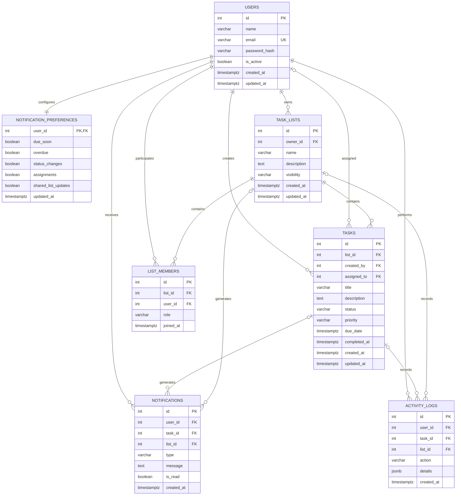

# TaskFlow - Diseño de base de datos

## 1. Información general

- Proyecto: TaskFlow
- Motor: PostgreSQL 18
- Administrador: pgAdmin 4
- ORM: SQLAlchemy
- Migraciones: Alembic
- Modelo: Relacional
- Versión del diseño: 1.0

## 2. Objetivo

Almacenar y gestionar de manera segura la información
de usuarios, tareas, listas, colaboradores,
notificaciones y actividades.

## 3. Diagrama entidad-relación

## 4. Diccionario de datos

### users

| Campo | Tipo | Restriccion |
|---|---|---|
| id | INTEGER | PK, IDENTITY |
| name | VARCHAR(100) | NOT NULL |
| email | VARCHAR(255) | UNIQUE, NOT NULL |
| password_hash | VARCHAR(255) | NOT NULL |
| is_active | BOOLEAN | NOT NULL, DEFAULT true |
| created_at | TIMESTAMPTZ | NOT NULL |
| updated_at | TIMESTAMPTZ | NOT NULL |

### task_lists

| Campo | Tipo | Restriccion |
|---|---|---|
| id | INTEGER | PK, IDENTITY |
| owner_id | INTEGER | FK users.id, NOT NULL |
| name | VARCHAR(100) | NOT NULL |
| description | TEXT | NULL |
| visibility | VARCHAR(10) | NOT NULL, DEFAULT private |
| created_at | TIMESTAMPTZ | NOT NULL |
| updated_at | TIMESTAMPTZ | NOT NULL |

### list_members

| Campo | Tipo | Restriccion |
|---|---|---|
| id | INTEGER | PK, IDENTITY |
| list_id | INTEGER | FK task_lists.id, NOT NULL |
| user_id | INTEGER | FK users.id, NOT NULL |
| role | VARCHAR(10) | NOT NULL |
| joined_at | TIMESTAMPTZ | NOT NULL |

### tasks

| Campo | Tipo | Restriccion |
|---|---|---|
| id | INTEGER | PK, IDENTITY |
| list_id | INTEGER | FK task_lists.id, NOT NULL |
| created_by | INTEGER | FK users.id, NOT NULL |
| assigned_to | INTEGER | FK users.id, NULL |
| title | VARCHAR(200) | NOT NULL |
| description | TEXT | NULL |
| status | VARCHAR(20) | NOT NULL, DEFAULT todo |
| priority | VARCHAR(10) | NOT NULL, DEFAULT medium |
| due_date | TIMESTAMPTZ | NULL |
| completed_at | TIMESTAMPTZ | NULL |
| created_at | TIMESTAMPTZ | NOT NULL |
| updated_at | TIMESTAMPTZ | NOT NULL |

### notifications

| Campo | Tipo | Restriccion |
|---|---|---|
| id | INTEGER | PK, IDENTITY |
| user_id | INTEGER | FK users.id, NOT NULL |
| task_id | INTEGER | FK tasks.id, NULL |
| list_id | INTEGER | FK task_lists.id, NULL |
| type | VARCHAR(30) | NOT NULL |
| message | TEXT | NOT NULL |
| is_read | BOOLEAN | NOT NULL, DEFAULT false |
| created_at | TIMESTAMPTZ | NOT NULL |

### activity_logs

| Campo | Tipo | Restriccion |
|---|---|---|
| id | INTEGER | PK, IDENTITY |
| user_id | INTEGER | FK users.id, NOT NULL |
| task_id | INTEGER | FK tasks.id, NULL |
| list_id | INTEGER | FK task_lists.id, NULL |
| action | VARCHAR(50) | NOT NULL |
| details | JSONB | NULL |
| created_at | TIMESTAMPTZ | NOT NULL |

### notification_preferences

| Campo | Tipo | Restriccion |
|---|---|---|
| user_id | INTEGER | PK, FK users.id |
| due_soon | BOOLEAN | NOT NULL, DEFAULT true |
| overdue | BOOLEAN | NOT NULL, DEFAULT true |
| status_changes | BOOLEAN | NOT NULL, DEFAULT true |
| assignments | BOOLEAN | NOT NULL, DEFAULT true |
| shared_list_updates | BOOLEAN | NOT NULL, DEFAULT true |
| updated_at | TIMESTAMPTZ | NOT NULL |

## 5. Estados y valores permitidos

### Estados de tareas

- todo
- in_progress
- done

### Prioridades

- low
- medium
- high
- urgent

### Visibilidad de listas

- private
- shared

### Roles

- owner
- editor
- viewer

Los valores permitidos se validaran mediante
restricciones CHECK y validaciones del backend.

## 6. Reglas de integridad

- Los correos electronicos seran unicos.
- Las claves primarias seran unicas.
- Las claves foraneas deben referenciar registros validos.
- La combinacion list_id y user_id sera unica.
- Cada lista tendra un propietario.
- Cada tarea pertenecera a una lista.
- Cada tarea tendra un creador.
- Cada usuario tendra un registro de preferencias.
- Las asignaciones respetaran los permisos de acceso.
- Las listas privadas no admitiran colaboradores.
- El propietario se identificara mediante owner_id.
- Los colaboradores tendran rol editor o viewer.

## 7. Seguridad

- Almacenamiento seguro de contrasenas mediante hashing.
- Validacion de permisos desde el backend.
- Consultas parametrizadas mediante SQLAlchemy.
- Credenciales mediante variables de entorno.
- Exclusiones de archivos sensibles en Git.

## 8. Normalizacion

El modelo busca reducir la duplicidad de informacion
mediante la separacion de entidades y el uso de
claves primarias y foraneas.

## 9. Indices previstos

- users.email (mediante UNIQUE)
- tasks.list_id
- tasks.created_by
- tasks.assigned_to
- tasks.status
- tasks.due_date
- task_lists.owner_id
- list_members.user_id
- list_members(list_id, user_id) (mediante UNIQUE)
- notifications.user_id
- activity_logs.user_id

## 10. Migraciones

Los cambios de estructura se gestionaran con Alembic.

## 11. Estado

Diseno inicial pendiente de implementacion y pruebas.

## Migraciones de base de datos

TaskFlow utiliza Alembic para gestionar los cambios
en el esquema de PostgreSQL.

Migración inicial:
d0a7908e20ec_create_initial_taskflow_tables.py

### Comandos principales

Consultar la migración actual:

python -m alembic current

Aplicar las migraciones pendientes:

python -m alembic upgrade head

Comprobar cambios pendientes en los modelos:

python -m alembic check

## Pruebas automatizadas

Las pruebas de integración de la base de datos
se encuentran en:

backend/app/tests/test_database.py

Se utiliza Pytest, SQLAlchemy y PostgreSQL.

### Pruebas implementadas

1. Crear un usuario.
2. Crear una lista y una tarea relacionadas.
3. Rechazar correos electrónicos duplicados.
4. Rechazar estados de tarea inválidos.
5. Rechazar prioridades inválidas.
6. Rechazar colaboradores duplicados.
7. Rechazar referencias a listas inexistentes.
8. Verificar eliminación CASCADE de tareas y miembros.
9. Verificar SET NULL en el historial de actividades.

### Ejecutar las pruebas

python -m pytest backend/app/tests/test_database.py -v

Resultado verificado: 9 pruebas superadas.

### Aislamiento de las pruebas

Cada prueba utiliza una transacción externa y
una sesión SQLAlchemy con SAVEPOINT.

Al finalizar, los cambios se revierten mediante
ROLLBACK, evitando conservar los registros
ficticios generados durante las pruebas.

Las pruebas deben ejecutarse únicamente en una
base de datos de desarrollo o pruebas.